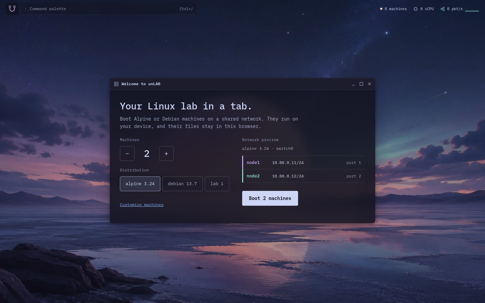
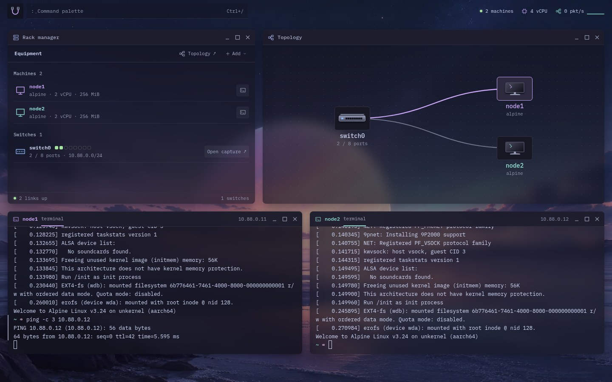

# unlab

A Linux network lab in one browser tab, built on
[pithings/unkernel](https://github.com/pithings/unkernel). Pooya Parsa and the
unkernel contributors made it possible to boot a real Linux kernel in
WebAssembly. `unlab` connects those machines to a virtual Ethernet switch so you
play with networking between linux boxes right in a tab. Send a ping, pull a
cable, and see what happens to the packets.

**[Open the live lab](https://unlab.run/)** ·
[Reach it from your terminal](#reach-the-lab-from-your-terminal) ·
[Run locally](#run-locally) · [Contribute](#contribute)

To open unlab in its own window, choose **Install** in Chrome’s address bar.
The installed app shares the lab and guest disks from your browser tab. Close
the tab before launching the app so it can open that lab.



## Follow your first ping

1. In **Welcome to unLAB**, select **Boot 2 machines**. The preview shows the
   names, addresses and switch ports before either guest starts. For CPU, disk
   and network settings, select **Customize machines**.
2. In **Rack manager**, select **node1**. When both guests are ready, select
   **Ping node2** under **Network**. The replies appear in node1’s terminal.
3. Beside **switch0** in the rack, select **Open capture** to follow traffic.
   For frame headers, cable filters and a Wireshark download, open the logo menu
   and choose **Packet capture → Packet inspector**.
4. Select **switch0** in the rack. Cut the cable to node2, watch its port block
   change, then reconnect it. Open **Topology** to see how the machines are wired.



Drag a window by its title bar, double-click to maximize it, or minimize it to
the bottom-left dock. Right-click a title bar, a machine, a switch or the desktop
for its actions. Returning to the lab restores your machines and desktop layout.
The [classic layout](https://unlab.run/?layout=classic) opens the same saved lab.

## Lab commands

Open the command bar with `⌘K` on macOS or `Ctrl+/` elsewhere. It completes
commands as you type and previews their effects. Run Linux commands directly in
a guest console, or use `exec` in the bar to address a guest by name. `help` lists
every command, and `help spawn` explains one, with its options and an example.

| Command bar example                          | What it does                                                                                                                           |
| -------------------------------------------- | -------------------------------------------------------------------------------------------------------------------------------------- |
| `ls`                                         | List machines and their disks, and each network interface's MAC, address, port, and link.                                              |
| `spawn 2 alpine --mem 512 --cpus 2 --disk 8` | Add two Alpine machines with 512 MiB of RAM, two CPUs, and an 8 GiB disk each. Use `--no-net` to leave them unplugged.                 |
| `spawn 1 lab`                                | Add an Alpine machine with network, service, and disk tools already installed.                                                         |
| `spawn 1 alpine --extra-disk 1,4`            | Add a machine with two blank disks of 1 and 4 GiB: `/dev/wdc` and `/dev/wdd`. A machine takes up to four, of up to 64 GiB each.        |
| `spawn 1 alpine --name web`                  | Add a machine called `web`. Every command takes the name, and it is the machine's hostname and what the others reach it by.            |
| `spawn 1 alpine --nics 2 --net switch0,none` | Add a machine with two network interfaces: `eth0` plugged in and `eth1` left unplugged. Without `--net`, each takes its own port.      |
| `spawn 1 alpine --addr 10.1.0.1/24`          | Add a machine with an address you choose. With `--nics`, give each interface an address or `none`: `--nics 2 --addr 10.1.0.1/24,none`. |
| `spawn 1 alpine --no-gateway`                | Add a machine on the switch but without the package gateway. DHCP on its `eth0` then goes to the other machines.                       |
| `mkswitch lan`                               | Add a switch called `lan`. Without a name, it is the next free `switch1`. Frames do not pass from one switch to another.               |
| `spawn 1 alpine --nics 2 --net switch0,lan`  | Add a machine with one network interface on each switch. `--net lan` puts every interface on `lan`.                                    |
| `rmswitch lan`                               | Remove a switch, after a confirmation that lists what is plugged in. Those interfaces are left unplugged, and the machines run on.     |
| `topology`                                   | List every switch, every port, what is in it, and whether its link is up.                                                              |
| `plug node2 lan:3`                           | Move node2's cable to port 3 of `lan`, or plug it in. `lan` alone is its lowest free port. Name one of several with `node2:eth1`.      |
| `unplug node2:eth1`                          | Take the interface's cable out and free its port, also for later boots.                                                                |
| `exec node1 -- ping -c 1 10.88.0.12`         | Send one ping from node1 and read the exit code from its shell.                                                                        |
| `write node1 /etc/motd --mode 644 -- hello`  | Put a text in a file on the machine, as root, with the directories it needs. `--owner user:group` sets whose it is.                    |
| `link down node2`                            | Cut node2's cables, whether it is on or off. Reconnect them with `link up node2`. Name one of several with `node2:eth1`.               |
| `capture arp or node2`                       | Maximise the capture with a filter for ARP or traffic involving node2. `node2:eth1` keeps one interface's frames.                      |
| `capture lan:3 icmp`                         | Show the pings that crossed one cable, the one in port 3 of `lan`. `lan` alone is all that the switch carried.                         |
| `sh node2`                                   | Open another shell on node2.                                                                                                           |
| `focus node2 --max`                          | Maximise or restore its pane. Use `--main` to promote it to the main pane.                                                             |
| `reboot node2`                               | Shut the machine down and boot it again, with its disks, name, addresses, and cables. `reboot` typed in the guest does the same.       |
| `poweroff node2`                             | Shut the machine down and leave it off. It keeps its disks and its ports, and uses no memory.                                          |
| `boot node2`                                 | Boot a machine that is off, or retry a failed boot.                                                                                    |
| `checkpoint node2 before`                    | Save all of the machine's disks as they are now, under a name. The machine runs on, or is off.                                         |
| `restore node2 before`                       | Put the disks back as they were at the checkpoint and boot, after a confirmation.                                                      |
| `forget node2 before`                        | Delete the checkpoint and free its storage, after a confirmation.                                                                      |
| `rm node2`                                   | Remove the machine and delete its disks and its checkpoints, after a confirmation that lists them.                                     |
| `help reboot`                                | Explain a command. `help` alone lists them all.                                                                                        |

In a capture filter, terms that follow one another must all match, and `or`
starts an alternative. A term is a protocol, a machine, an interface, an address,
a MAC, a switch, a cable such as `lan:3`, or `port:3` for that port of every
switch. A machine or an interface is matched on every switch that its frames went
through, so a ping across routers shows each hop, in order. With several switches,
each row says which one carried the frame and the ports it came in by and went out
of. **save .pcap** saves everything captured, or only the frames shown when the
filter names a switch or a cable.

Commands that accept multiple machines can take a list (`node1,node3`), a glob
(`node*`), or `all`. Globs and `all` select the machines that the command can act
on, such as the ready ones for `exec` and the ones that are off or failed for `boot`.

## Reach the lab from your terminal

Run this on the computer your browser is on:

```sh
npx unlab.run
```

It opens the lab, or finds the one you have open. The first time, your browser asks
whether unlab.run may reach apps on your device. Allow it, and the prompt is linked:

```
Linked to the lab: node1 (alpine), node2 (debian)
unlab> ssh node2
user@node2:~$ curl -sI https://example.org | head -1
HTTP/2 200
```

You need Node.js 22.12 or later, OpenSSH, and Chrome or Chromium, on Linux or macOS. It
has been used with Chromium 155.

| At the prompt                        | What it does                                                                                          |
| ------------------------------------ | ----------------------------------------------------------------------------------------------------- |
| `ssh node1`                          | Open a shell in a machine. `ssh root@node1` is root's, and `ssh node1 -- uname -a` runs one command.  |
| `forward web 8080:80`                | Make port 80 of `web` port 8080 of your computer. `forward` lists them, `forward --rm 8080` ends one. |
| `status`                             | Say what is linked and forwarded, and which connections machines have open.                           |
| `spawn 2 alpine`, and all the others | Run a lab command, with the lab's own completion. One that asks first asks here.                      |

To keep it running without a terminal, as a job in the background: `npx unlab.run > unlab.log &`. It runs
until it is stopped, as any program is: `kill` it, or Ctrl-C at its prompt.
Any command runs from a shell too, and exits with the machine's own status:
`npx unlab.run exec node1 -- uname -a`. Add `--json` before it for its data, and
`--yes` for a command that asks first. `npx unlab.run --help` lists the options.

### Copy files, and use your own ssh

While the CLI runs, `ssh`, `scp` and `rsync` reach a machine from any terminal by its
name and `.unlab`. Add the line that `npx unlab.run ssh-config` prints to the top of your
`~/.ssh/config`, then:

```sh
scp ./site.tar node1.unlab:/tmp/
scp -3 node1.unlab:/tmp/site.tar node2.unlab:/tmp/
rsync -a ./src/ node1.unlab:src/
ssh -L 8080:localhost:80 node1.unlab
```

`scp -3` copies from one machine to another through your computer. To leave your own `~/.ssh/config` as it is,
give ssh the CLI's instead: `ssh -F ~/.config/unlab/ssh_config node1.unlab`.

The CLI has keys of its own in `~/.config/unlab`, and reads and writes none of yours. It
works with any image, and with machines that have no network. To reach one for the first
time, the lab puts an SSH server (dropbear, with sftp-server and rsync) in the machine's
memory, at `/run/unlab-ssh`. The server listens on `127.0.0.1:47022` in the machine, or
the next free port, and takes only the CLI's key. None of it is on a disk or in a
checkpoint, no switch carries it, and port 22 stays yours. A reboot removes it.

### The internet

While the CLI is linked, each machine that has a gateway reaches the internet through
your computer: names, and TCP connections to IPv4 addresses. Package downloads take the
same path. It starts and ends on running machines, and `ls` says which have it.
`--no-gateway` leaves a machine out. It carries no `ping`, UDP or IPv6, and nothing on
the internet can connect to a machine. `npx unlab.run --log` prints each connection.

Sites see your computer's address. A machine cannot reach your computer or your local
network this way, by address or by name, unless you start the CLI with `--lan`.

### If it does not link

Open **SSH access** in the logo menu to see the connection and turn the link on or off. A
lab that has never linked does not look for a CLI.

| Status line    | What to do                                                                            |
| -------------- | ------------------------------------------------------------------------------------- |
| `cli: off`     | Run `npx unlab.run`, or click it and turn the link on.                                |
| `cli: waiting` | Run `npx unlab.run`. If it runs, look for your browser's question in the lab's tab.   |
| `cli: blocked` | Select the icon left of the address, allow access to apps on your device, and reload. |
| `cli: refused` | Click it to read why. The lab or the CLI may be out of date: `npx unlab.run@latest`.  |

Commands from the CLI do not go through the agent panel's `ask me` settings. An agent with
a shell can use the CLI, so it can do what you can.

## Use the lab with an AI agent

An agent can boot machines, run commands in them, cut cables, and read the
capture. unlab registers its lab commands with your browser through
[WebMCP](https://developer.chrome.com/docs/ai/webmcp/imperative-api), and the
agent calls them through that browser. The lab needs no server and no account.
The tools exist only while the lab is open in a tab.

You need Chrome 150 or later. WebMCP is a Chrome trial feature, so Firefox and
Safari do not have it.

### Connect Claude Code

You also need Node.js 22.12 or later.

1. Add the Chrome DevTools MCP server with its WebMCP tools turned on:

   ```sh
   claude mcp add --scope user unlab -- npx -y chrome-devtools-mcp@latest \
     --categoryExperimentalWebmcp --chromeArg=--enable-features=WebMCP \
     --no-javascript-evaluation --no-category-input
   ```

   If you use Chromium, or Chrome is not in its default place, also add
   `--executablePath=` with the browser's full path. `command -v chromium` prints
   Chromium's.

2. Start a new Claude Code session and ask:

   > Open https://unlab.run/ and use its WebMCP tools to boot two
   > Alpine machines and check that they can ping each other.

3. A Chrome window opens on the lab. When the agent asks to boot the machines, the
   agent panel opens. Click **Boot node1 and node2**.

The window has its own profile, so its lab is separate from the one in your
everyday browser.

Keep the last two flags. Without them, the server also lets the agent click and
run JavaScript in the page, so it could approve its own calls. The server sends
usage statistics to Google unless you add `--no-usage-statistics`.

To change the flags later, run `claude mcp remove --scope user unlab`, then add the
server again. A running session keeps the old flags until you reconnect `unlab` in
`/mcp` or restart Claude Code.

In another MCP client, add a server with the command `npx` and the arguments
that follow it in step 1.

### Use the browser you already have open

The server can attach to your own browser instead of opening a window, so the
agent works with the lab in your open tab.

**The agent can then see every tab in that browser, including sites you are
signed in to.** It can read and screenshot those pages and navigate the tabs. Use
the separate window unless you need this.

1. Open `chrome://inspect/#remote-debugging` in your browser and turn on remote
   debugging.
2. Add the server with `--autoConnect` in place of `--chromeArg` and any
   `--executablePath`:

   ```sh
   claude mcp add --scope user unlab -- npx -y chrome-devtools-mcp@latest \
     --categoryExperimentalWebmcp --autoConnect \
     --no-javascript-evaluation --no-category-input
   ```

   For Chromium on Linux, also add `--userDataDir=$HOME/.config/chromium`.

3. Ask the agent to use the lab that is already open. The lab runs in one tab at a
   time, so a second tab will not load it. Your browser may ask you to allow the
   connection.

When you are done, turn remote debugging off.

### Connect a browser extension

1. [Open the lab](https://unlab.run/) in Chrome and open **WebMCP** from the logo menu.
2. To see a call without an agent, click **try a call**. The
   call and its result appear in the panel.
3. Install
   [WebMCP - Model Context Tool Inspector](https://chromewebstore.google.com/detail/webmcp-model-context-tool/gbpdfapgefenggkahomfgkhfehlcenpd).
   It lists the tools in the tab. To ask for work in plain language, give it a
   Gemini API key.

The live lab turns WebMCP on in Chrome by itself. For your own copy, open
`chrome://flags/#enable-webmcp-testing`, choose **Enabled**, and relaunch Chrome.

### Things to ask for

- "Cut node2's cable, ping it from node1, and show me the ARP requests."
- "Boot two machines on switch0 and show me the first ping in the capture."

### Choose what runs without asking

The agent panel sets each tool to `run`, `ask me`, or `off`. A call to an
`ask me` tool waits until you approve or deny it. **pause tools** hides all of
them. Your choices survive a reload.

| Tool                 | What it does                             | Default  |
| -------------------- | ---------------------------------------- | -------- |
| `lab_help`           | Explain the commands and the tools.      | `run`    |
| `machines_list`      | List machines, addresses, links, disks.  | `run`    |
| `topology_read`      | List switches, ports and cables.         | `run`    |
| `machines_spawn`     | Boot machines.                           | `ask me` |
| `machines_boot`      | Boot machines that are off or failed.    | `run`    |
| `machines_reboot`    | Reboot machines.                         | `run`    |
| `machines_poweroff`  | Shut machines down and keep their disks. | `run`    |
| `machines_remove`    | Remove machines and delete their disks.  | `ask me` |
| `switch_add`         | Add a switch.                            | `run`    |
| `switch_remove`      | Remove a switch and unplug its cables.   | `ask me` |
| `checkpoint_save`    | Save a machine's disks as they are now.  | `run`    |
| `checkpoint_restore` | Go back to a checkpoint and boot.        | `ask me` |
| `checkpoint_remove`  | Delete a checkpoint.                     | `ask me` |
| `shell_exec`         | Run a command in a guest's shell.        | `run`    |
| `shell_read`         | Read what a guest's terminal shows.      | `run`    |
| `file_write`         | Put a text in a file on a machine.       | `run`    |
| `link_set`           | Cut or reconnect a machine's cables.     | `run`    |
| `cable_plug`         | Plug a NIC in, or move its cable.        | `run`    |
| `cable_unplug`       | Unplug a NIC and free its port.          | `run`    |
| `capture_read`       | Read captured frames from the switches.  | `run`    |

Commands run inside the guests, not on your computer. Guest output can contain
text that tries to instruct the agent, so unlab marks it as untrusted.

### If the agent cannot call the tools

| Status line                      | What to do                                                                                       |
| -------------------------------- | ------------------------------------------------------------------------------------------------ |
| `webmcp: not available`          | Turn on the flag above, or check that the MCP server has `--chromeArg=--enable-features=WebMCP`. |
| `webmcp: blocked`                | Click it to read the browser's reason.                                                           |
| `webmcp: paused`                 | Click it, then click **resume tools**.                                                           |
| `webmcp: 1 call waiting for you` | Click it, then approve or deny the call.                                                         |

If the server reports `Could not find Google Chrome executable`, add
`--executablePath=` as in step 1 of [Connect Claude Code](#connect-claude-code). If
a separate window opens when you wanted your own browser, reconnect `unlab` in
`/mcp`.

## Network and storage

- A lab has up to eight machines and eight switches. It starts with `switch0`, which
  stays. A switch has eight ports. A machine has one to four network interfaces, and
  each takes a port on a switch or is left unplugged. `link up` plugs one that is
  unplugged into `switch0`, and `plug` into any. A switch carries IPv4 traffic between its
  guests. A separate gateway on `eth0` provides access to package repositories, whichever
  switch `eth0` is on.
- `lan:3` is port 3 of the switch `lan`. A cable moves as it is, so one that is cut stays
  cut until `link up`. The switch that it leaves forgets what it learned from it. A machine
  that fails boots on the switch its cable was moved to, at the lowest free port.
- Select a switch in **Rack manager** for its ports, connected guests and cable actions.
- Unless you choose, `eth0` starts with an address in `10.88.0.0/24` and `eth1` and
  up start without one. `--addr` sets one in any subnet. The lab applies the
  addresses it set again at every boot, and `/etc/hosts` in each machine lists
  every machine's first one. To make a machine a router, run
  `sudo sysctl -w net.ipv4.ip_forward=1` in it.
- While [the CLI is linked](#the-internet), the gateway leads to the internet.
- The package gateway also gives `eth0` the address `10.0.2.15` and a default
  route, and it answers DHCP there. `--no-gateway` leaves all three to you. With
  the gateway on, `10.0.2.0/24` and `198.51.100.0/24` are its own. A machine spawned with
  `eth0` on `none` has no gateway, and plugging it in later does not add one.
- Each guest defaults to 256 MiB of RAM, a sparse 4 GiB disk, and two CPUs, or
  one CPU if the browser lacks multicore support. The disk uses browser storage
  as the guest writes to it.
- `/dev/wda` is the image, `/dev/wdb` keeps the guest's files, and the disks that
  `--extra-disk` adds follow from `/dev/wdc`. An extra disk starts blank, and the lab
  never formats or mounts one. The lab image partitions it with
  `sfdisk` or `parted` and formats it with `mkfs.ext4`. Alpine and Debian have no
  formatter for a file system their kernel mounts, so install one first: on Alpine,
  `sudo apk add e2fsprogs`.
- A machine that is shut down or rebooted saves everything its guest has written to a
  disk first. Its programs, and settings that only its memory held, are gone. Shells
  opened beside the console close, and the console says so. A guest that does not shut
  down within 10 seconds is stopped, and the lab says that too.
- A checkpoint is all of a machine's disks at one moment. The guest first writes its
  files to them, and it runs on while they are copied: about 10 seconds for each GiB
  that the disks hold. A checkpoint takes as much storage as that, which the
  machine's details and `ls` show, and goes with its machine. `restore` stops a
  running guest without shutting it down, and boots afresh: programs and memory are
  not saved. The machine's other checkpoints stay. It takes about 20 seconds for each
  GiB, and room for another copy of the disks while it runs. One that a reload
  cuts short starts again, and one that fails leaves the disks as they were.
- `write` and `file_write` replace a whole file, or leave it as it was, and the file
  is on the machine's disk when they are done. The text is written byte for byte, in
  UTF-8 and up to 1 MiB. The bar is one line, so a text of several lines comes from
  an agent. A file that is there keeps its owner and mode unless you give them, and
  a new one is root's with mode 644. New directories have mode 755 and belong to
  the `--owner` or to root. A link is followed. Write a space in a path as `\ `, and
  a backslash as `\\`. No terminal sees it, and the log leaves long texts out.
- Reloading the page boots each machine from its own IndexedDB-backed disks, except
  those that are off, which stay off. Switches, ports and cable connections survive a
  reload. Shell processes and packet captures start fresh. One tab at a time owns the
  lab.
- A machine that the browser has no memory or storage left for fails with a sentence
  that says which. Remove a machine or free some space, then use `boot`.

## Install packages

Run these commands in the guest console:

| Guest  | Example                                     |
| ------ | ------------------------------------------- |
| Alpine | `sudo apk update && sudo apk add vim`       |
| Debian | `sudo apt update && sudo apt install -y jq` |
| Lab    | As on Alpine.                               |

The browser downloads indexes and packages over HTTPS from the configured
[Alpine mirror](https://repo.c48.uk/alpine/) or
[Debian mirror](https://github.com/pithings/unkernel/blob/c08e977/web/src/config.ts#L166-L173).
Alpine includes both `main` and `community`. The package managers verify the
distribution signatures, and installed packages persist on the guest disk.

The gateway accepts only package repository requests, unless
[the CLI is linked](#the-internet). It requires no Wisp relay. Switch cable controls affect traffic between guests independently.
Use `spawn 1 alpine --no-gateway` to boot without repository access. A machine
from the lab image then still has iproute2, tcpdump, curl, dig, ssh and sshd, nginx,
strace, and tools to partition and format a disk.

## Run locally

With Node.js 24 and npm installed, clone the repository and start the dev
server.

```sh
git clone https://github.com/gregbell/unlab.git
cd unlab
npm ci
npm run distros -- alpine debian lab
npm run dev
```

Open the URL printed by Vite. The distro download checks each root image's size
and SHA-256 against the unkernel release that matches the pinned npm package, or,
for the lab image, against [its pin](scripts/lab-image.ts).
The kernel comes directly from that package's `unkernel.wasm`. The
[image manifest](public/distros/distros.json) records the upstream build IDs and
checksums.

The lab image is Alpine with packages installed. It is a
[release asset](https://github.com/gregbell/unlab/releases/tag/lab-image-1) that
[this script](scripts/build-lab-image.ts) built.

The SSH programs in [public/ssh](public/ssh/) are built from pinned releases by
[this script](scripts/build-ssh-server.ts): `npm run ssh-server`, which needs
[Zig](https://ziglang.org) and make. To use the CLI with your own copy of the lab,
`npm run cli` builds it, and
`node cli/dist/cli.mjs --origin http://localhost:5173` takes that lab's pages.

## How it works

Each guest runs in its own worker. When Linux sends an Ethernet frame, the
[virtual switch](src/runtime/switch.ts) forwards it and the
[capture](src/capture/) records it. The capture panel decodes those same bytes.
Terminal output goes straight to the terminal, so the UI can update the capture
once per animation frame.

unkernel drives one network device, which is `eth0`. The others are TAP devices
that a [small helper](src/runtime/unlab-nic.c) holds open in the guest, with their
frames on its stdin and stdout. The built helper is checked in. After changing its
source, rebuild it with `npm run nic-helper`, which needs
[Zig](https://ziglang.org).

The [CLI](cli/src/) listens on this computer, and the lab's [page](src/link/) and each
machine's [worker](src/runtime/machine-link.ts) connect to it: the page for commands, and
a worker for [streams](src/streams/) both ways, SSH into its machine and connections out
of it. A browser asks the person before a page may do that.

The [command registry](src/commands/verbs/) serves the buttons, command bar, agent tools,
and the CLI. The [model](src/model/) turns events into state changes and
effects. The [runtime](src/runtime/) carries them out. For the reasoning behind
those boundaries, read the [architecture notes](.audit/arch/synthesis.md).

## Contribute

For a bug report, include the browser, guest distribution, and commands that
reproduce it. For a change, describe what someone can do or observe in the lab.
If people would notice it, also add an entry to [What’s new](src/ui/whats-new/updates.ts).
[Open an issue](https://github.com/gregbell/unlab/issues) ·
[Open a pull request](https://github.com/gregbell/unlab/compare)

After local setup, run the checks that cover your change.

| Command                    | Coverage                                                                     |
| -------------------------- | ---------------------------------------------------------------------------- |
| `npm run check`            | Type checking, lint, import boundaries, unit tests, and the production build |
| `npm run test:integration` | Linux guests switching and routing traffic in Node.js                        |
| `npm run test:browser`     | UI components and guest workers in Chromium                                  |
| `npm run test:e2e`         | The built app, including the first boot, ping, and reload                    |

For the browser and end-to-end suites, install Chromium with
`npx playwright install chromium` or set `CHROMIUM_PATH` to a Chromium
executable.

### Turn WebMCP on for visitors

With an origin trial token, visitors to a deployed lab do not need the Chrome
flag. Register `https://unlab.run` for the
[WebMCP origin trial](https://developer.chrome.com/origintrials/#/register_trial/4163014905550602241),
then set the repository variable `UNLAB_ORIGIN_TRIAL_TOKENS` to the token. The
Pages workflow adds it to the page. Separate several tokens with spaces. Each
token has an expiry date. To renew one, update the variable and run the workflow
again. Chrome's trial ends on 30 March 2027.

## Licence and acknowledgements

unlab's code is available under the [MIT licence](LICENSE). Thank you to Pooya
Parsa and the [unkernel contributors](https://github.com/pithings/unkernel) for
the kernel, JavaScript SDK, and distro builds that power every machine in this
lab.
