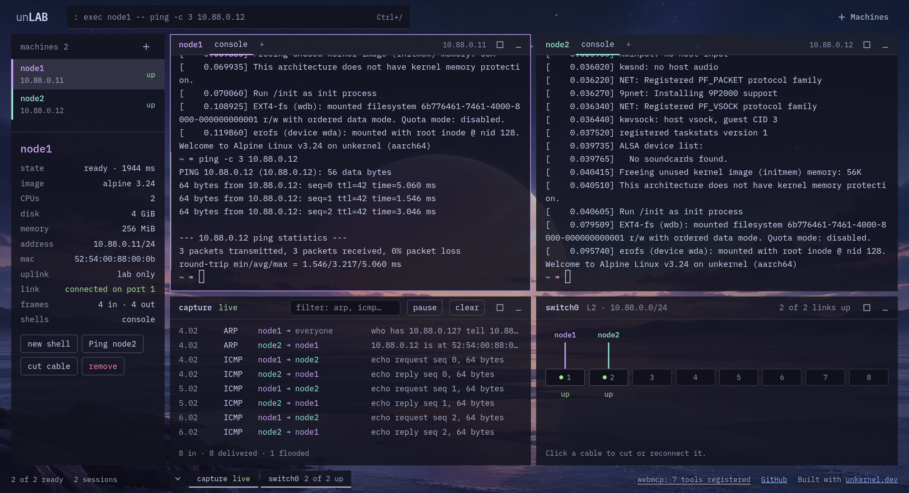

# unlab

A Linux network lab in one browser tab, built on
[pithings/unkernel](https://github.com/pithings/unkernel). Pooya Parsa and the
unkernel contributors made it possible to boot a real Linux kernel in
WebAssembly. `unlab` connects those machines to a virtual Ethernet switch so you
play with networking between linux boxes right in a tab. Send a ping, pull a
cable, and see what happens to the packets.

**[Open the live lab](https://gregbell.github.io/unlab/)** ·
[Run locally](#run-locally) · [Contribute](#contribute)



## Follow your first ping

1. Open the live lab and select **Boot 2 machines**. When both Alpine guests are
   ready, their addresses appear beside their names.
2. Select **Ping node2**. The replies appear in the `node1` console. In the
   capture below it, the first ARP request asks who has `10.88.0.12`. The ICMP
   echo requests and replies follow.
3. Select **expand** in the capture to open the Wire view. Select a frame to
   inspect its headers, or choose **save .pcap** to download a capture you can
   open in Wireshark.

To see what a broken link looks like, press `Esc` to return to the consoles and
click the cable above port 2. Ping again, then click the cable to reconnect it.

## Lab commands

Open the command bar with `⌘K` on macOS or `Ctrl+/` elsewhere. It completes
commands as you type and previews their effects. Run Linux commands directly in
a guest console, or use `exec` in the bar to address a guest by name.

| Command bar example                          | What it does                                                                                                           |
| -------------------------------------------- | ---------------------------------------------------------------------------------------------------------------------- |
| `ls`                                         | List machines, addresses, and link states.                                                                             |
| `spawn 2 alpine --mem 512 --cpus 2 --disk 8` | Add two Alpine machines with 512 MiB of RAM, two CPUs, and an 8 GiB disk each. Use `--no-net` to leave them unplugged. |
| `exec node1 -- ping -c 1 10.88.0.12`         | Send one ping from node1 and read the exit code from its shell.                                                        |
| `link down node2`                            | Cut node2's cable. Reconnect it with `link up node2`.                                                                  |
| `capture arp or node2`                       | Open the Wire view with a filter for ARP or traffic involving node2.                                                   |
| `sh node2`                                   | Open another shell on node2.                                                                                           |
| `focus node2 --max`                          | Maximise or restore its pane. Use `--main` to promote it to the main pane.                                             |
| `boot node2`                                 | Retry a failed boot.                                                                                                   |
| `rm node2`                                   | Remove the machine and delete its disk after confirmation.                                                             |

Commands that accept multiple machines can take a list (`node1,node3`), a glob
(`node*`), or `all`. Globs and `all` select ready machines.

## Use the lab with an AI agent

An agent can boot machines, run commands in them, cut cables, and read the
capture. unlab registers its lab commands with your browser through
[WebMCP](https://developer.chrome.com/docs/ai/webmcp/imperative-api), and the
agent calls them through that browser. The lab needs no server and no account.
The tools exist only while the lab is open in a tab.

You need Chrome 150 or later. WebMCP is a Chrome trial feature, so Firefox and
Safari do not have it.

### Connect Claude Code

You also need Node.js 22.12 or later.

1. Add the Chrome DevTools MCP server with its WebMCP tools turned on:

   ```sh
   claude mcp add --scope user unlab -- npx -y chrome-devtools-mcp@latest \
     --categoryExperimentalWebmcp --chromeArg=--enable-features=WebMCP \
     --no-javascript-evaluation --no-category-input
   ```

   If you use Chromium, or Chrome is not in its default place, also add
   `--executablePath=` with the browser's full path. `command -v chromium` prints
   Chromium's.

2. Start a new Claude Code session and ask:

   > Open https://gregbell.github.io/unlab/ and use its WebMCP tools to boot two
   > Alpine machines and check that they can ping each other.

3. A Chrome window opens on the lab. When the agent asks to boot the machines, the
   agent panel opens. Click **Boot node1 and node2**.

The window has its own profile, so its lab is separate from the one in your
everyday browser.

Keep the last two flags. Without them, the server also lets the agent click and
run JavaScript in the page, so it could approve its own calls. The server sends
usage statistics to Google unless you add `--no-usage-statistics`.

To change the flags later, run `claude mcp remove --scope user unlab`, then add the
server again. A running session keeps the old flags until you reconnect `unlab` in
`/mcp` or restart Claude Code.

In another MCP client, add a server with the command `npx` and the arguments
that follow it in step 1.

### Use the browser you already have open

The server can attach to your own browser instead of opening a window, so the
agent works with the lab in your open tab.

**The agent can then see every tab in that browser, including sites you are
signed in to.** It can read and screenshot those pages and navigate the tabs. Use
the separate window unless you need this.

1. Open `chrome://inspect/#remote-debugging` in your browser and turn on remote
   debugging.
2. Add the server with `--autoConnect` in place of `--chromeArg` and any
   `--executablePath`:

   ```sh
   claude mcp add --scope user unlab -- npx -y chrome-devtools-mcp@latest \
     --categoryExperimentalWebmcp --autoConnect \
     --no-javascript-evaluation --no-category-input
   ```

   For Chromium on Linux, also add `--userDataDir=$HOME/.config/chromium`.

3. Ask the agent to use the lab that is already open. The lab runs in one tab at a
   time, so a second tab will not load it. Your browser may ask you to allow the
   connection.

When you are done, turn remote debugging off.

### Connect a browser extension

1. [Open the lab](https://gregbell.github.io/unlab/) in Chrome. The bottom right
   reads `webmcp: 7 tools registered`.
2. To see a call without an agent, click that text, then click **try a call**. The
   call and its result appear in the panel.
3. Install
   [WebMCP - Model Context Tool Inspector](https://chromewebstore.google.com/detail/webmcp-model-context-tool/gbpdfapgefenggkahomfgkhfehlcenpd).
   It lists the tools in the tab. To ask for work in plain language, give it a
   Gemini API key.

The live lab turns WebMCP on in Chrome by itself. For your own copy, open
`chrome://flags/#enable-webmcp-testing`, choose **Enabled**, and relaunch Chrome.

### Things to ask for

- "Cut node2's cable, ping it from node1, and show me the ARP requests."
- "Boot two machines on switch0 and show me the first ping in the capture."

### Choose what runs without asking

The agent panel sets each tool to `run`, `ask me`, or `off`. A call to an
`ask me` tool waits until you approve or deny it. **pause tools** hides all of
them. Your choices survive a reload.

| Tool              | What it does                            | Default  |
| ----------------- | --------------------------------------- | -------- |
| `machines_list`   | List machines, addresses, and links.    | `run`    |
| `machines_spawn`  | Boot machines.                          | `ask me` |
| `machines_remove` | Remove machines and delete their disks. | `ask me` |
| `shell_exec`      | Run a command in a guest's shell.       | `run`    |
| `shell_read`      | Read what a guest's terminal shows.     | `run`    |
| `link_set`        | Cut or reconnect a machine's cable.     | `run`    |
| `capture_read`    | Read captured frames from the switch.   | `run`    |

Commands run inside the guests, not on your computer. Guest output can contain
text that tries to instruct the agent, so unlab marks it as untrusted.

### If the agent cannot call the tools

| Status line                      | What to do                                                                                       |
| -------------------------------- | ------------------------------------------------------------------------------------------------ |
| `webmcp: not available`          | Turn on the flag above, or check that the MCP server has `--chromeArg=--enable-features=WebMCP`. |
| `webmcp: blocked`                | Click it to read the browser's reason.                                                           |
| `webmcp: paused`                 | Click it, then click **resume tools**.                                                           |
| `webmcp: 1 call waiting for you` | Click it, then approve or deny the call.                                                         |

If the server reports `Could not find Google Chrome executable`, add
`--executablePath=` as in step 1 of [Connect Claude Code](#connect-claude-code). If
a separate window opens when you wanted your own browser, reconnect `unlab` in
`/mcp`.

## Network and storage

- The switch has eight ports and supports up to eight machines. Each guest has
  one network interface. The switch carries IPv4 traffic between guests. A
  separate gateway on that interface provides access to package repositories.
- Each guest defaults to 256 MiB of RAM, a sparse 4 GiB disk, and two CPUs, or
  one CPU if the browser lacks multicore support. The disk uses browser storage
  as the guest writes to it.
- Reloading the page boots each machine from its own IndexedDB-backed ext4 disk.
  Switch ports and cable connections survive a reload. Shell processes and
  packet captures start fresh. One tab at a time owns the lab.

## Install packages

Run these commands in the guest console:

| Guest  | Example                                     |
| ------ | ------------------------------------------- |
| Alpine | `sudo apk update && sudo apk add vim`       |
| Debian | `sudo apt update && sudo apt install -y jq` |

The browser downloads indexes and packages over HTTPS from the configured
[Alpine mirror](https://repo.c48.uk/alpine/) or
[Debian mirror](https://github.com/pithings/unkernel/blob/c08e977/web/src/config.ts#L166-L173).
Alpine includes both `main` and `community`. The package managers verify the
distribution signatures, and installed packages persist on the guest disk.

The gateway accepts only package repository requests. It requires no Wisp
relay. Switch cable controls affect traffic between guests independently.
Use `spawn 1 alpine --no-net` to boot without repository access.

## Run locally

With Node.js 24 and npm installed, clone the repository and start the dev
server.

```sh
git clone https://github.com/gregbell/unlab.git
cd unlab
npm ci
npm run distros -- alpine debian
npm run dev
```

Open the URL printed by Vite. The distro download checks each root image's size
and SHA-256 against the unkernel release that matches the pinned npm package.
The kernel comes directly from that package's `unkernel.wasm`. The
[image manifest](public/distros/distros.json) records the upstream build IDs and
checksums.

## How it works

Each guest runs in its own worker. When Linux sends an Ethernet frame, the
[virtual switch](src/runtime/switch.ts) forwards it and the
[capture](src/capture/) records it. The Wire view decodes those same bytes.
Terminal output goes straight to the terminal, so the UI can update the capture
once per animation frame.

The [command registry](src/commands/verbs/) serves the buttons, command bar, and
agent tools. The [model](src/model/) turns events into state changes and
effects. The [runtime](src/runtime/) carries them out. For the reasoning behind
those boundaries, read the [architecture notes](.audit/arch/synthesis.md).

## Contribute

For a bug report, include the browser, guest distribution, and commands that
reproduce it. For a change, describe what someone can do or observe in the lab.
[Open an issue](https://github.com/gregbell/unlab/issues) ·
[Open a pull request](https://github.com/gregbell/unlab/compare)

After local setup, run the checks that cover your change.

| Command                    | Coverage                                                                     |
| -------------------------- | ---------------------------------------------------------------------------- |
| `npm run check`            | Type checking, lint, import boundaries, unit tests, and the production build |
| `npm run test:integration` | Two Linux guests exchanging traffic across the switch in Node.js             |
| `npm run test:browser`     | UI components and guest workers in Chromium                                  |
| `npm run test:e2e`         | The built app, including the first boot, ping, and reload                    |

For the browser and end-to-end suites, install Chromium with
`npx playwright install chromium` or set `CHROMIUM_PATH` to a Chromium
executable.

### Turn WebMCP on for visitors

With an origin trial token, visitors to a deployed lab do not need the Chrome
flag. Register the site's origin for the
[WebMCP origin trial](https://developer.chrome.com/origintrials/#/register_trial/4163014905550602241),
then set the repository variable `UNLAB_ORIGIN_TRIAL_TOKENS` to the token. The
Pages workflow adds it to the page. Separate several tokens with spaces. Each
token has an expiry date. To renew one, update the variable and run the workflow
again. Chrome's trial ends on 30 March 2027.

## Licence and acknowledgements

unlab's code is available under the [MIT licence](LICENSE). Thank you to Pooya
Parsa and the [unkernel contributors](https://github.com/pithings/unkernel) for
the kernel, JavaScript SDK, and distro builds that power every machine in this
lab.
